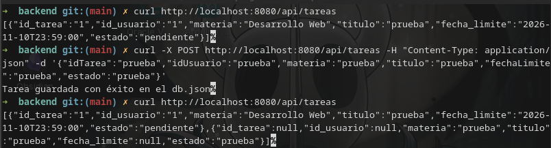

# Reporte de IA Desarrollo en el Proyecto

**Fecha:** 13/11/2026  
**Número de reporte:** 2  

---

# 1. Breve descripción de uso

Se utilizo para la creacion de un archivo de configuracion para la dependencia de security porque no debaja pasar las solicitudes del curl

---

# 2. Evidencias de uso

| Evidencia                   | Formato                                                                                                                                                                                                                                                                                                                                                                                                                                                                                                                                                                                                                                                                                                                                                                                                                                                                                                                                                                                                                                                                                                                                                                                                    |
| --------------------------- | ---------------------------------------------------------------------------------------------------------------------------------------------------------------------------------------------------------------------------------------------------------------------------------------------------------------------------------------------------------------------------------------------------------------------------------------------------------------------------------------------------------------------------------------------------------------------------------------------------------------------------------------------------------------------------------------------------------------------------------------------------------------------------------------------------------------------------------------------------------------------------------------------------------------------------------------------------------------------------------------------------------------------------------------------------------------------------------------------------------------------------------------------------------------------------------------------------------- |
| Herramienta                 | Gemini                                                                                                                                                                                                                                                                                                                                                                                                                                                                                                                                                                                                                                                                                                                                                                                                                                                                                                                                                                                                                                                                                                                                                                                                     |
| Modelo/temperatura          | -                                                                                                                                                                                                                                                                                                                                                                                                                                                                                                                                                                                                                                                                                                                                                                                                                                                                                                                                                                                                                                                                                                                                                                                                          |
| Prompt original             | [promp](Promp.md)                                                                                                                                                                                                                                                                                                                                                                                                                                                                                                                                                                                                                                                                                                                                                                                                                                                                                                                                                                                                                                                                                                                                                                                          |
| Respuesta de IA             | [Respuesta](respuesta.md)                                                                                                                                                                                                                                                                                                                                                                                                                                                                                                                                                                                                                                                                                                                                                                                                                                                                                                                                                                                                                                                                                                                                                                                  |
| Código anterior             | 4b0c7da                                                                                                                                                                                                                                                                                                                                                                                                                                                                                                                                                                                                                                                                                                                                                                                                                                                                                                                                                                                                                                                                                                                                                                                                    |
| Código posterior            | 60687f3                                                                                                                                                                                                                                                                                                                                                                                                                                                                                                                                                                                                                                                                                                                                                                                                                                                                                                                                                                                                                                                                                                                                                                                                    |
| Diferencias entre versiones | diff --git a/backend/src/main/java/mx/uv/desarrolloweb/SecurityConfig.java b/backend/src/main/jav a/mx/uv/desarrolloweb/SecurityConfig.java new file mode 100644 index 0000000..4c40d41 --- /dev/null +++ b/backend/src/main/java/mx/uv/desarrolloweb/SecurityConfig.java @@ -0,0 +1,20 @@ +package mx.uv.desarrolloweb; + +import org.springframework.context.annotation.Bean; +import org.springframework.context.annotation.Configuration; +import org.springframework.security.config.annotation.web.builders.HttpSecurity; +import org.springframework.security.web.SecurityFilterChain; + +@Configuration +public class SecurityConfig { + +    @Bean +    public SecurityFilterChain securityFilterChain(HttpSecurity http) throws Exception {  +        http +            .csrf(csrf -> csrf.disable()) // Desactiva protección CSRF para permitir peti ciones POST/PUT +            .authorizeHttpRequests(auth -> auth +                .anyRequest().permitAll() // Permite el acceso libre a cualquier endpoint  +            ); +        return http.build(); +    } +} \ No newline at end of file |
| Prueba de funcionamiento    |                                                                                                                                                                                                                                                                                                                                                                                                                                                                                                                                                                                                                                                                                                                                                                                                                                                                                                                                                                                                                                                                                                                                                                                            |
| Código de uso               | Depuración / Modificación                                                                                                                                                                                                                                                                                                                                                                                                                                                                                                                                                                                                                                                                                                                                                                                                                                                                                                                                                                                                                                                                                                                                                                                  |
| Reflexión del estudiante    | Comprendi un poco el uso de la dependencia de security y como "desactivarla"                                                                                                                                                                                                                                                                                                                                                                                                                                                                                                                                                                                                                                                                                                                                                                                                                                                                                                                                                                                                                                                                                                                               |

---

## Observaciones adicionales

Se configuró el acceso libre de manera temporal para agilizar las pruebas funcionales con CURL y herramientas externas antes de integrar la autenticación definitiva con el frontend.